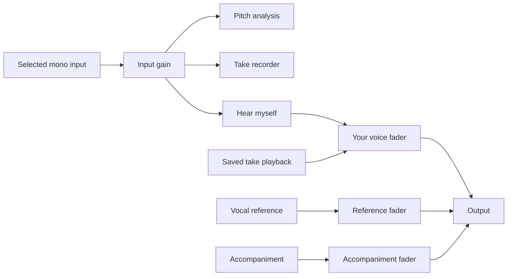

# DAW setup patterns applied to Voice v0.5

Documentation reviewed on 2026-11-18. This is a focused review of official manuals, not a competitor application test or a claim of feature/latency parity.

## Sources and versions

- **REAPER 7.86**, official [User Guide index](https://www.reaper.fm/userguide.php) and [manual, file revision 786c](https://www.reaper.fm/userguide/ReaperUserGuide786c.pdf). Relevant sections: 1.15.2 (macOS audio setup, p. 22), 3.3 (project media, p. 58), 3.4-3.5 (input, record arm, monitoring and levels, pp. 59-60).
- **Pro Tools 2024.6**, [Reference Guide](https://resources.avid.com/SupportFiles/PT/Pro_Tools_Reference_Guide_2024.6.pdf): Playback Engine (pp. 106-108), global/local preferences (pp. 162-163), Save Copy In (pp. 200-203), record enable (p. 615), input monitoring and monitor levels (pp. 621-623). This review is pinned to **2024.6**. The current [official documentation index](https://kb.avid.com/pkb/articles/en_US/Knowledge/Pro-Tools-Documentation) already lists **2026.11**; its newer reference guide was not reviewed here. Page numbers refer to printed pages, not PDF page indices.
- **Ableton Live 12**, [Routing and I/O](https://www.ableton.com/en/live-manual/12/routing-and-i-o/), sections 17.1, 17.2, 17.2.1 and 17.5.1.
- **GarageBand for Mac**, Apple guides for [Audio/MIDI settings](https://support.apple.com/guide/garageband/change-audiomidi-settings-gbnd967819b9/mac), [microphone connection and mono input selection](https://support.apple.com/guide/garageband/connect-a-microphone-gbnd4f4680f6/mac), and [input monitoring](https://support.apple.com/guide/garageband/turn-on-input-monitoring-for-audio-tracks-gbnd4bc15233/mac). The actual topic bodies were reviewed; navigation/footer text was excluded.

## Patterns and concrete decisions

| Verified manual pattern | Voice v0.5 application |
| --- | --- |
| Device setup precedes track routing. REAPER has Audio/Device preferences; Pro Tools has Playback Engine; GarageBand has separate input/output device settings. Pro Tools distinguishes global from session-local preferences. | Remember device names, mono input channel, requested buffer, input gain and timing correction on this Mac. New/open projects use those preferences. Keep mix levels and recorded takes in the project. |
| A single microphone uses one mono channel. REAPER recommends a mono input for one microphone; GarageBand explicitly selects the interface channel and mono format; Live exposes individual channels and mono/stereo configuration. | Choose the interface and the actual microphone channel in the Mixer sidebar. Record that channel as mono, rather than silently summing the interface's inputs. |
| Recording and monitoring are separate controls. REAPER separates record arm and Monitor Input. Pro Tools separates Record Enable and TrackInput. Live offers In/Auto/Off monitoring; GarageBand has a Monitoring button. | **Mic** enables pitch capture; **Hear myself** enables audible monitoring; **Record take** writes audio while the reference plays. Recording does not require audible monitoring. |
| Capture level and mix level have different roles. REAPER §3.5 explicitly says the track volume fader controls playback, not recording level. Pro Tools documents monitor fader levels separately. Live names pre-FX, post-FX and post-mixer routing points. | Hardware/input gain affects the captured signal. The **Your voice** fader controls monitoring and take playback after capture; it does not change saved PCM or pitch analysis. Reference and accompaniment have independent playback faders. |
| Check signal presence and avoid overload. REAPER's recording checklist calls for auditioning the input without clipping; Live places activity/overload meters beside input-channel choices. | Show input level and the two playback levels beside the faders. First set the microphone/interface gain for an unclipped input; then balance what is heard with the faders. A quieter monitor mix does not repair clipped input. |
| Media must travel with a session. REAPER offers Copy all media into project directory; Pro Tools Save Copy In offers All Audio Files. | Every `.voice` save includes the referenced original recordings and recorded takes, plus analysis, traces and results. Reopening does not depend on the import locations. |

## Signal path

The saved take is the selected microphone signal after input gain, not the mixed reference/accompaniment output. Software monitoring starts off. With interface direct monitoring, leave **Hear myself** off to avoid hearing two monitor paths; Apple and Ableton also describe monitoring as an explicit choice.

## Voice setup and practice

1. Stage **Vocal reference** and optional **Accompaniment**, choose one voice or several voices/notes, then Continue. Confirm a selected line when the reference is polyphonic.
2. Select input/output devices and the mono input channel in the persistent Mixer sidebar. Use **Advanced… / Cmd+,** for buffer, capture gain and manual timing correction. Device preferences are saved independently of the song.
3. Turn on **Mic** and allow macOS access when requested. Check the input meter. Enable **Hear myself** only when wanted, then balance the three faders.
4. Seek to a passage and choose **Record take**. Stop, let the file finish, then choose **Listen** in Takes or **Listen to take** in the sidebar. Playback shows the saved trace and stored result. Changing the current tolerance does not recompute that result.
5. Save the project. Format v2 packages original audio and take PCM. Existing v1 projects open through migration; their pitch-only history cannot produce audio that was never recorded.

The DAWs also provide extensive routing, editing, plug-in and latency features outside Voice's scope. Voice's buffer request can fall back to a driver-supported size, and its timing correction remains manual. Source documentation establishes the design precedent; actual Voice runtime evidence belongs in [VALIDATION.md](VALIDATION.md).
